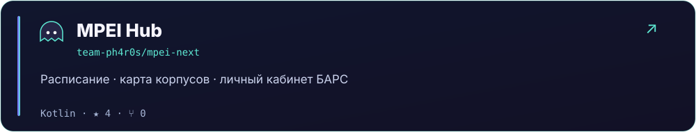
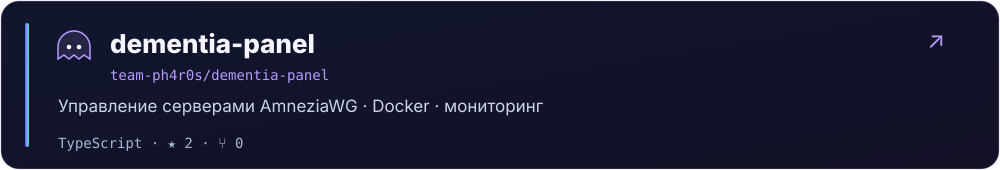
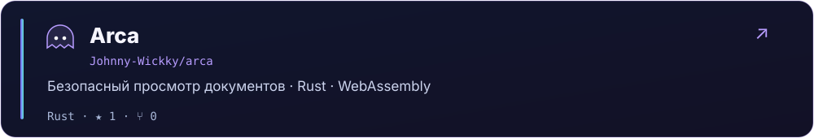

 

  

 

## 👻 Обо мне

Привет, я **Speedy** — участник [Team Ph4r0s](https://github.com/team-ph4r0s). Работаю над мобильными приложениями и инструментами, люблю Kotlin, Call of Duty и обсуждать идеи с нейросетями.

🎓 Развиваем **MPEI Hub**: расписание, карта корпусов и БАРС для студентов и преподавателей МЭИ.

> Move fast, ship things, stay spooky. 👻

 

## 🛡 Команда

<table>
  <tr>
    <td width="96" align="center">
      
    </td>
    <td>
      <b>Участник <a href="https://github.com/team-ph4r0s">Team Ph4r0s</a></b> 
      Разрабатываем вместе — например, <a href="https://github.com/team-ph4r0s/dementia-panel"><code>dementia-panel</code></a>, панель управления серверами AmneziaWG.
    </td>
  </tr>
</table>

 

## 🛠 Стек

 

## 🚀 Проекты

[Репозиторий MPEI Hub](https://github.com/team-ph4r0s/mpei-next) · [Релизы](https://github.com/team-ph4r0s/mpei-next/releases)

 

## 📊 Статистика

  

  

 

Starred — репозитории, которые я отметил звёздой; Own repo stars — звёзды публичных репозиториев моего аккаунта. Contributions — данные GitHub за последний год на момент обновления; значения могут отличаться от профиля из-за времени обновления и настроек приватности.

 

## 🐍 Змейка из коммитов

<picture>
  <source media="(prefers-color-scheme: dark)" srcset="https://raw.githubusercontent.com/ghostoftheeleven/ghostoftheeleven/output/github-contribution-grid-snake-dark.svg" />
  <source media="(prefers-color-scheme: light)" srcset="https://raw.githubusercontent.com/ghostoftheeleven/ghostoftheeleven/output/github-contribution-grid-snake.svg" />
  
</picture>

 

## 📬 Связь

 

## 🎮 Вне кода

- 🔫 Call of Duty — основной способ перезагрузить мозг
- 🤖 Долгие разговоры с нейросетями — от идей до рефакторинга

 

Спасибо, что заглянули 👻 · Статистика обновляется автоматически

