<div align="center">



<br/>

<a href="https://github.com/ghostoftheeleven?tab=followers"></a>
<a href="https://github.com/ghostoftheeleven?tab=repositories"></a>
<a href="https://github.com/ghostoftheeleven?tab=stars"></a>
<a href="https://t.me/flspeedy"></a>

</div>

<br/>

## 👻 Обо мне

```ts
const speedy = {
  nickname: "ghostoftheeleven",
  loves:    ["Call of Duty", "быстрые решения", "чистый код"],
  net_worth: "billionaire (по версии моего воображения)",
  chats_with: "нейросетями — постоянно",
  stack:    ["Kotlin", "TypeScript", "Rust", "Docker"],
  motto:    "Move fast, ship things, stay spooky.",
};
```

<br/>

## 🛠 Стек

<div align="center">


</div>

<br/>

## 🚀 Проекты

<div align="center">

<a href="https://github.com/tonykolomeytsev/mpeiapp">
  
</a>
<a href="https://github.com/team-ph4r0s/dementia-panel">
  
</a>
<a href="https://github.com/Johnny-Wickky/arca">
  
</a>

</div>

| Проект | Что это | Язык |
| :-- | :-- | :-: |
| 🎓 **mpei-next** | Расписание пар, карта корпусов и личный кабинет БАРС для студентов и преподавателей НИУ МЭИ |  |
| 🛡 **dementia-panel** | Agentless-ПО для управления серверами AmneziaWG: деплой в Docker по SSH, мониторинг, учёт пользователей, автообновляемые конфиги |  |
| 🔐 **arca** | Параноидально безопасный FOSS-пакет для iOS/Android: Office, Visio 3D и Access в изолированной Wasm-песочнице на Rust |  |

<br/>

## 📊 Статистика

<div align="center">


<br/>


</div>

<br/>

## 🐍 Змейка из коммитов

<div align="center">

<picture>
  <source media="(prefers-color-scheme: dark)" srcset="https://raw.githubusercontent.com/ghostoftheeleven/ghostoftheeleven/output/github-contribution-grid-snake-dark.svg" />
  <source media="(prefers-color-scheme: light)" srcset="https://raw.githubusercontent.com/ghostoftheeleven/ghostoftheeleven/output/github-contribution-grid-snake.svg" />
  
</picture>

</div>

<br/>

## 📬 Связь

<div align="center">

<a href="https://t.me/flspeedy"></a>

</div>

<br/>

## 🎮 Вне кода

- 🔫 Call of Duty — основной способ перезагрузить мозг
- 🤖 Долгие разговоры с нейросетями — от идей до рефакторинга
- 💸 Мечтаю о миллиардах, пока что коплю коммиты

<br/>

<div align="center">


<sub>Спасибо, что заглянули 👻 · Обновлено вручную с любовью</sub>

</div>
