 

  

 

## 👻 Обо мне

  

Привет, я **Speedy** — участник [Team Ph4r0s](https://github.com/team-ph4r0s). Делаю мобильные приложения и инструменты, люблю Kotlin и хорошие идеи, которые доходят до релиза.

- 🎓 Развиваю **[MPEI Hub](https://github.com/team-ph4r0s/mpei-next)** — расписание, карта корпусов и БАРС для студентов и преподавателей МЭИ
- 🛡 Вместе с командой пилю **[dementia-panel](https://github.com/team-ph4r0s/dementia-panel)** — панель управления серверами AmneziaWG
- 🔫 Перезагружаюсь в Call of Duty, а идеи и рефакторинг обсуждаю с нейросетями

 

## 🛠 Стек

<table align="center">
  <tr>
    <th align="left">📱 Мобайл</th>
    <td align="center"></td>
  </tr>
  <tr>
    <th align="left">⚙️ Языки</th>
    <td align="center"></td>
  </tr>
  <tr>
    <th align="left">🧰 Инфра</th>
    <td align="center"></td>
  </tr>
</table>

 

## 🚀 Проекты

<a href="https://github.com/team-ph4r0s/mpei-next">Репозиторий</a> · <a href="https://github.com/team-ph4r0s/mpei-next/releases">Скачать релиз</a>

 

## 🛡 Команда

<table align="center">
  <tr>
    <td width="96" align="center">
      
    </td>
    <td>
      <b>Участник <a href="https://github.com/team-ph4r0s">Team Ph4r0s</a></b> 
      Разрабатываем вместе: MPEI Hub, <a href="https://github.com/team-ph4r0s/dementia-panel"><code>dementia-panel</code></a> и не только.
    </td>
  </tr>
</table>

 

## 📊 Статистика

  

  

 

<b>Starred</b> — репозитории, отмеченные мной звездой · <b>Own repo stars</b> — звёзды моих публичных репозиториев · <b>Contributions</b> — вклад за последний год. Цифры обновляются каждые 6 часов и могут немного расходиться с профилем.

 

## 🐍 Змейка из коммитов

<picture>
  <source media="(prefers-color-scheme: dark)" srcset="https://raw.githubusercontent.com/ghostoftheeleven/ghostoftheeleven/output/github-contribution-grid-snake-dark.svg" />
  <source media="(prefers-color-scheme: light)" srcset="https://raw.githubusercontent.com/ghostoftheeleven/ghostoftheeleven/output/github-contribution-grid-snake.svg" />
  
</picture>

 

### 📬 Есть идея или вопрос? Пишите

  

Спасибо, что заглянули 👻 · Move fast, ship things, stay spooky

